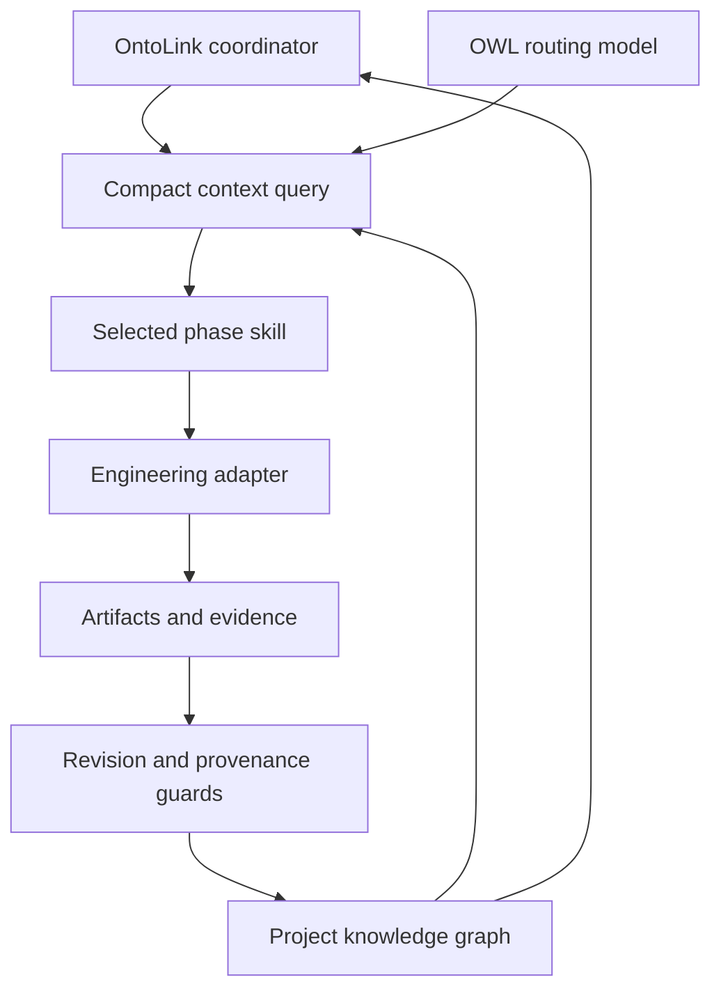
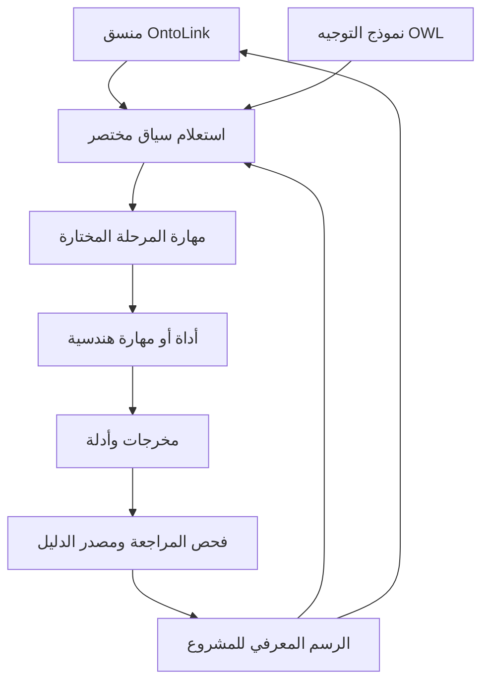

# OntoLink Skills — AI Agent Skills and Ontology-Based Project Workflows

[English](#english) · [العربية](#العربية)

<a id="english"></a>

## English

OntoLink Skills provides eight AI agent skills for ontology-based project management,
persistent project memory, evidence-based software delivery and coding-agent workflows.
The original architectural explanation and practical guide are retained below,
followed by installation, safe updates, agent prompts, comparisons and answers.
Only outdated rule paths and the broken attribution link have been corrected.

### OntoLink Skills

**Ontology-mediated project execution, from discovery to monitoring.**

OntoLink connects sequential agent skills through an OWL knowledge model and a persistent project graph. It retrieves the current task, relevant dependencies, evidence and signals instead of repeatedly loading every skill and the complete project history.


## How the parts connect



## Sequential skills

| Order | Skill | Required outcome |
| --- | --- | --- |
| Coordinator | `ontolink-skills` | Canonical knowledge, routing and handoffs |
| 1 | `ontolink-discovery` | Requirements and acceptance criteria |
| 2 | `ontolink-architecture` | Reviewed contracts and architecture |
| 3 | `ontolink-planning` | Dependency-aware execution plan |
| 4 | `ontolink-implementation` | Working implementation |
| 5 | `ontolink-verification` | Current verification evidence |
| 6 | `ontolink-delivery` | Authorized delivery and handoff |
| 7 | `ontolink-monitoring` | Observed health and follow-up work |

## Start a project

Install all eight directories under `skills/` through your agent host's supported skill mechanism. Keep the directories together by skill name; phase skills resolve the coordinator by name. Invoke `$ontolink-skills` with your project goal. Optional engineering adapters must be installed separately when needed.

The mediator requires Python 3.10+ and the standard library for normal operation:

```sh
python skills/ontolink-skills/scripts/mediator.py init   --project support-tracker --title "Support Tracker" --output /path/to/project/knowledge.owl
python skills/ontolink-skills/scripts/mediator.py context   --state /path/to/project/knowledge.owl
```

The OWL model is [ontolink.owl](skills/ontolink-skills/assets/ontolink.owl). Its readable Turtle mirror is [ontolink.ttl](skills/ontolink-skills/assets/ontolink.ttl). Operational project knowledge is stored in a separate `knowledge.owl` at the actual project root. JSON is a command payload and compact query result, not the canonical storage format.

## What the graph tracks

Requirements, contracts, tasks, artifacts, evidence, decisions, recommendations, warnings, blockers, actors, communications, confidence assessments, event likelihood and audit events have explicit relationships. Progress is computed from accepted task weights. Confidence measures evidence strength; likelihood concerns a specified event and time horizon. Neither closes a task or overrides a blocker.

A task closes only after predecessor phases are complete, its required artifact has current PASS evidence, and blocking signals are resolved. Changed artifacts, contracts or upstream knowledge reopen affected work. Message records do not send messages; non-draft records require an external receipt.

## Token-use design

Token reduction is an objective, not a measured result. OWL text is not inherently smaller than Markdown. Savings come from selecting the current phase, retaining only relevant dependency closure, referencing long artifacts by path and hash, and reusing state across handoffs. Mandatory blockers, contracts and evidence are retained even when the estimated packet budget overflows. The byte-based estimate covers packet content only; measure actual provider usage before claiming a saving.

## Documentation and validation

- [Quickstart and recording workflow](docs/quickstart.md)
- [Knowledge model and relationships](docs/knowledge-model.md)
- [Lifecycle and handoff rules](docs/lifecycle.md)
- [Validation and limitations](docs/validation.md)
- [Skill catalogue](catalog.json)
- [Primary standards and attribution](skills/ontolink-skills/assets/sources.json)

```sh
python -m pip install -r requirements-dev.txt
python scripts/check.py
```

The runtime is a constrained named-node RDF/XML mediator, not a general OWL reasoner. Hash checks establish local file provenance; an agent must still inspect whether a proof demonstrates the claimed outcome. Monitoring requires active work or separately configured automation.


---

## Project ontology: automatic setup and practical operation

### 1. Automatic creation at the project root

When an AI agent first uses OntoLink in a project, it must automatically create or reuse `knowledge.owl` in the actual project root before starting phase work. The user does not need to ask for an ontology file or repeat a setup instruction. The agent resolves the target project, inspects existing canonical state, and invokes the bundled mediator's `bootstrap` command. Installation alone does not execute code; automatic setup happens during the first project-scoped invocation in a host that can run Python and write project files.

```sh
python <skill-root>/scripts/mediator.py bootstrap --root "<project-root>"
```

The command derives a project ID and title from the directory name unless explicitly supplied, creates seven incomplete phase tasks, and returns a context packet. If `knowledge.owl` already exists, it validates and reuses the file without rewriting its contents or resetting progress. An explicitly configured canonical state path remains authoritative; the agent must not create a second graph. An ambiguous root must be resolved before writing. Invalid state, an active writer lock, or missing capabilities must be reported rather than concealed by reinitialization.

### 2. What the ontology file represents

`knowledge.owl` is the project's persistent knowledge and execution state graph. It records requirements, contracts, tasks, dependencies, artifacts, evidence, decisions, blockers and other operational signals as explicit nodes and relationships. It is distinct from the bundled `ontolink.owl` schema, which defines the vocabulary and workflow routing. Keeping these responsibilities separate lets many projects share the same model while retaining independent state.

The state uses RDF/XML and OWL vocabulary. It is semantic data, not executable application code. The Python mediator reads the supported representation, queries focused context and enforces operational guards. Its parser is deliberately constrained to named-node RDF/XML; it is not a general OWL reasoner and does not support arbitrary RDF/XML constructs.

### 3. How persistent knowledge supports a project

The root graph gives future sessions a durable starting point: what has been accepted, what remains open, which outcomes are required and which dependencies matter. A new agent queries the current graph and inspects the relevant source and evidence before continuing. Persistence supports continuity, but accuracy still depends on recording real changes and keeping the graph synchronized with the project.

OntoLink coordinates discovery, architecture, planning, implementation, verification, delivery and monitoring. Required outcomes and predecessor guards prevent accepted completion from skipping earlier obligations. The initialized tasks describe work to perform; they are not proof that a product has been built, tested or deployed.

### 4. Evidence, provenance and completion

A task can become `DONE` only when its required outcome has current `PASS` evidence, predecessor phases are complete and blocking signals are resolved. Evidence references a local proof file and SHA-256 hashes for both the proof and its target artifact. These checks detect mismatches and establish traceable local provenance.

A matching hash does not prove that a test ran, that the proof is meaningful or that the software is correct. The agent must inspect the command, environment, output and acceptance criteria before recording `PASS`. This makes unsupported completion claims harder to accept through the mediator, but does not eliminate hallucination. Progress measures accepted task weight, not overall product quality; confidence and likelihood never substitute for completion evidence.

### 5. Selective retrieval and token use

OWL is not inherently smaller than Markdown. The intended efficiency comes from retrieving focused context instead of repeatedly loading the full graph, every skill and the complete project history. A context packet selects the current task, relevant dependency closure, contracts, blockers and evidence references. Long artifacts remain in files and are read selectively when needed.

Packet size depends on project complexity, dependency depth and required facts. There is no guaranteed character range or measured universal token saving. The mediator's budget is a byte-based estimate for packet content; mandatory facts remain even if the estimate overflows. Measure actual provider usage, including skill instructions and tool output, before claiming a percentage reduction.

### 6. What an agent reads before changing code

The agent first queries the mediator to establish the current task, phase and constraints. It then reads the relevant source files, tests, configuration and evidence required for that work. The graph guides navigation; it does not contain or replace the complete application source. A wider inspection remains appropriate when dependencies or an unfamiliar architecture require it.

After a meaningful change, the agent records the new facts and artifact revisions through the mediator, queries fresh context and validates the state before handoff. Writes use the observed revision and a cooperating-writer lock. A revision conflict requires rereading current state, not bypassing the guard.

### 7. Change impact and monitoring

Relationships such as `dependsOn`, `usesArtifact` and `derivedFrom` connect work to its prerequisites and inputs. Recorded upstream changes can reopen reachable tasks and mark dependent artifacts stale. Unexpected file-byte changes are detected during validation; they require reconciliation and a recorded revision before normal work continues. Impact tracking is only as complete as the relationships that have been recorded.

Resolving a blocker makes work eligible again; it does not restore stale evidence or manufacture completion. Monitoring occurs during active work and resume. Continuous background monitoring requires separately configured automation. Similarly, message records do not send messages, and a graph entry cannot prove an external deployment or provider integration without actual receipts.

### 8. Ontology and Markdown work together

Markdown serves human explanation, narrative decisions and documentation. The ontology gives selected project facts explicit identities, relationships and queryable state. The mediator supplies the programmatic guards; the file format alone does not enforce governance. Both formats are useful when their responsibilities are clear.

| Aspect | Markdown documentation | OntoLink project graph |
| --- | --- | --- |
| Primary purpose | Human explanation and context | Structured operational knowledge |
| Relationships | Described in prose or links | Explicit graph edges |
| Validation | Depends on document tooling | Mediator guards and optional SHACL checks |
| Change impact | Usually tracked manually | Traverses recorded dependencies |
| Evidence | Described or linked | Artifact and proof hashes with outcome records |
| Best use | Guides and narrative rationale | State, routing and controlled handoffs |

Keep the graph in the project alongside its source, keep secrets out of records and proof logs, and use Markdown for the explanation people need. This combination supports repeatable AI-assisted engineering with durable context and reviewable evidence.

**Implementation references:** [Coordinator instructions](skills/ontolink-skills/SKILL.md), [Python mediator](skills/ontolink-skills/scripts/mediator.py), [execution contract](skills/ontolink-skills/references/execution-contract.md), [knowledge model](docs/knowledge-model.md), and [lifecycle](docs/lifecycle.md).

## Optional Project Intelligence extension

For large codebases, OntoLink can build a **generated, non-canonical code index** at `.ontolink/index/project-index.json`. This keeps source-code symbols out of `knowledge.owl`: the OWL state remains authoritative for project knowledge and execution state, while the generated index can be deleted and rebuilt at any time.

The optional extension supports incremental indexing, local BM25 retrieval across canonical project knowledge plus code/file hints, and a backward-compatible context wrapper that preserves the mediator's existing fields. It does not change the seven-phase lifecycle, completion gates, evidence rules or revision checks.

See [Project Intelligence extension](docs/project-intelligence.md).


## Where to install the Ontology-First rule

The canonical rule and the agent-host entry points are included in this repository. To make a host apply the rule to a **different application repository**, copy the applicable files into that application's repository root; rules stored only in the OntoLink Skills repository do not automatically govern a separate repository.

| Purpose / host | File to place in the target project | How to use it |
| --- | --- | --- |
| Full canonical policy | `.rule/ONTOLOGY-FIRST.md` | Keep the detailed rule here. |
| General agent instruction | `AGENTS.md` | Recommended root entry point for compatible coding agents. |
| Cursor | `.cursor/rules/ontology-first.mdc` | Cursor rule with `alwaysApply: true`. |
| Cline | `.clinerules` | Project-level Cline instructions. |
| Gemini CLI | `GEMINI.md` | Project-level Gemini instructions. |
| GitHub Copilot | `.github/copilot-instructions.md` | Repository-wide Copilot instructions. |

Keep one canonical copy of the detailed policy at `.rule/ONTOLOGY-FIRST.md`; host-specific files should point to it and repeat the mandatory first action. Do not create unrelated rule files or duplicate the full policy in every host file.

### Required project layout

In the **target application repository**, the rule files sit beside the application's source, and the project's own `knowledge.owl` sits at its root (unless the project already has an explicitly configured canonical state path). The mediator path depends on how the OntoLink skill was installed: resolve the actual installed `ontolink-skills/scripts/mediator.py` path rather than assuming `.agents/skills/...` exists in every environment. Query context first; if the project ontology is absent, bootstrap it through that mediator and then query context.

| Target-project path | Purpose |
| --- | --- |
| `.rule/ONTOLOGY-FIRST.md` | Canonical policy |
| `.rule/ontolink.py` | Record and refresh adapter |
| `AGENTS.md`, `GEMINI.md` | General-agent and Gemini entry points |
| `.cursor/rules/ontology-first.mdc`, `.clinerules`, `.github/copilot-instructions.md` | Optional host entry points |
| `knowledge.owl` | Canonical project state |
| `.ontolink/` | Generated record JSON, text, proofs, context and optional index |
| Application source and tests | Native project files |

Only add the host-specific file for the tool you actually use. These files instruct an agent; they do not install the skill or execute the mediator by themselves. Install OntoLink and ensure the host can run Python 3.10+ before relying on automatic context retrieval.

## Terminal installation: all eight AI agent skills

The complete setup path requires Git and Python 3.10+. Use a separate distribution
checkout, outside the application project. Stop active agent work while installing
or updating. The project path must already exist.

```sh
git clone https://github.com/asgmodel/ontolink-skills.git /path/to/ontolink-distribution
python /path/to/ontolink-distribution/scripts/project_setup.py \
  --project /path/to/my-project --skills-dir .agents/skills
```

The setup command copies all eight skill packages and `.rule` files, merges a
managed instruction block into `AGENTS.md` and `GEMINI.md`, creates or reuses the
project graph, and refreshes context. Existing replaced files are backed up under
`.ontolink/backups/`. Unrelated skills and unrelated host instructions are preserved.
The required Project Intelligence companion reference is installed beside the
skill parent, so the unchanged coordinator's relative documentation link resolves.
The default skill directory is `.agents/skills`; choose your host's supported
project skill directory explicitly when it differs. Reload the agent if its host
requires a session restart to discover new or updated skills.

An optional community installer is the [Vercel Skills CLI](https://github.com/vercel-labs/skills).
With Node.js/npm available, this installs the skill packages for a selected agent:

```sh
npx skills add asgmodel/ontolink-skills --skill '*' --agent codex --yes
```

Replace `codex` with your supported agent. This command installs skill packages;
run the complete setup above to add the external `.rule` integration as well.
Do not mix installers for the same target directory without reviewing which
installation owns it. The Python path is the tested complete repository workflow;
the third-party CLI is an optional alternative with its own version and behavior.

## Install prompt for any coding agent

Copy the following prompt into an agent that can access Git, run Python and write
files. Replace the project path. A chat-only agent cannot execute installation.

```text
Install OntoLink Skills from https://github.com/asgmodel/ontolink-skills.git
for the existing project at /absolute/path/to/my-project.
Use a separate distribution checkout outside that project. Read its README and
.rule/ONTOLOGY-FIRST.md. Resolve this host's actual project skill directory.
Run scripts/project_setup.py with --project and --skills-dir to install all eight
skills and the external rules. Preserve unrelated skills, user instructions,
knowledge.owl, records, proofs and application files. Honor an existing explicit
canonical state path with --state. Do not reset state or claim any phase is DONE.
Inspect the returned context, load the selected phase only, and report the actual
installed paths, backup location, current revision and any failed capabilities.
```

## Update existing skills without losing project data

**Yes. A project can retain its recorded knowledge while its installed skill
packages gain new instructions, scripts or commands.** Skill code is installed
separately from project data. New package files are copied on update; they do not
require rebuilding the project's graph or repeating completed phases.

From the same distribution checkout used for installation:

```sh
git -C /path/to/ontolink-distribution pull --ff-only origin main
python /path/to/ontolink-distribution/scripts/project_setup.py \
  --project /path/to/my-project --skills-dir .agents/skills
```

These are the two update commands: fetch the current distribution, then synchronize
all eight packages and rules into the existing project. A dirty or diverged Git
checkout must be resolved before pulling; do not use `reset --hard` to hide local
changes. Updates occur when these commands run, not through an unattended service.

The setup utility checks existing graph compatibility using the incoming mediator
before replacing packages, backs up replaced paths, refreshes context after setup,
and verifies that existing graph bytes have not changed. It preserves existing
`.ontolink/records/`, `proofs/`, `artifacts/` and application files. An optional
code index may be rebuilt. Package or rule-copy failure restores the replaced
paths. Backups include local customizations; merge those deliberately after update.
Invalid state or an incompatible future schema stops the update; automatic schema
migration is not promised. Newly added commands are available after the new package
is installed, subject to your host reloading its instructions.

For an existing installation created with the community CLI, its own update command
can update the named packages. It does not synchronize the repository's external rules:

```sh
npx skills update ontolink-skills ontolink-discovery ontolink-architecture \
  ontolink-planning ontolink-implementation ontolink-verification \
  ontolink-delivery ontolink-monitoring --project
```

If the old installation contains only the eight copied skill folders, first clone
the distribution and run `project_setup.py` against their actual parent directory.
It backs up those copies before synchronizing them and preserves existing project
knowledge. Never copy a bundled example graph over the project's `knowledge.owl`.

## Update prompt for any coding agent

```text
Update the existing OntoLink installation for /absolute/path/to/my-project from
https://github.com/asgmodel/ontolink-skills.git. Identify the actual distribution
checkout, installation method, project skill directory and canonical state first.
Pause active work, inspect local modifications, and fast-forward the distribution
without discarding local changes. Read the incoming README and canonical rule.
Run its scripts/project_setup.py against the existing project and skill directory,
passing --state for an existing explicit graph. Preserve graph bytes, recorded
knowledge, proof files, generated artifacts, application source and unrelated skills.
Keep the backup of replaced files and report its location. Validate with the incoming
mediator; do not reinitialize state or invent schema migrations. If compatibility
fails, stop and explain the failure. Refresh context, report old/new package versions
and newly available commands, and reload agent instructions when required.
```

## Resume or run a project by prompt

```text
Use $ontolink-skills for this project. Read .rule/ONTOLOGY-FIRST.md and resolve
the installed coordinator. Create or reuse the canonical project state through
the supported start command. Read the current context, select the eligible phase,
and continue the authorized work. Keep generated JSON and text under .ontolink,
record factual changes with the observed revision, and refresh context after each
successful record. Preserve existing application architecture and user changes.
```

## Operations: initialization, context, records and validation

From the application root after complete setup, use the installed coordinator path:

```sh
python .rule/ontolink.py start --root . --skill-root .agents/skills/ontolink-skills
python .rule/ontolink.py context --root . --skill-root .agents/skills/ontolink-skills
python .rule/ontolink.py record --root . --skill-root .agents/skills/ontolink-skills \
  --input .ontolink/records/scope-001.json --expected-revision 0
python .agents/skills/ontolink-skills/scripts/mediator.py validate --state knowledge.owl
```

The `record` example requires an actual JSON payload and the current revision;
it is not an instruction to reuse revision zero for later writes. See the
[recording quickstart](docs/quickstart.md). `record` validates and refreshes context
after success. When a record commits but refresh fails, rerun `context`; do not
resubmit the already committed record. `.ontolink` has the same fixed name in every
project. Retain durable records, proofs and artifacts during cache cleanup.

## Comparison: OntoLink, Markdown and other engineering skills

| Aspect | OntoLink Skills | A standalone engineering skill | Markdown project notes |
| --- | --- | --- | --- |
| Primary job | Coordinate phase work and persistent project knowledge | Perform its domain task with its available tools | Explain decisions and context for people |
| Cross-session continuity | Canonical graph, revision and selected context | Depends on that skill's implementation | Depends on what is recorded and reread |
| Dependencies | Explicit graph relationships and ordered phase gates | Depends on the skill | Usually narrative or linked text |
| Evidence | Artifact/proof hashes plus workflow guards | Depends on the skill | Can describe or link proof |
| Implementation capability | Routes to available tools and optional adapters | Supplies its own specialized procedure | No execution mechanism by itself |
| Best combination | Coordinator for a multi-phase project | Adapter for concrete implementation or verification | Human-facing explanations alongside structured facts |

This is a comparison of responsibilities, not a benchmark or a claim that all other
skills lack state or validation. OntoLink can coordinate a full-stack or specialized
skill without replacing it. Markdown remains useful and is not less valuable than
a graph; choose each for the job it serves.

## Frequently asked questions

### Is this one skill or a collection?

Eight installable skills: one coordinator and seven sequential phase skills.
Use the [catalogue](catalog.json) and the linked phase entry points below.

| Skill documentation | Role |
| --- | --- |
| [ontolink-skills](skills/ontolink-skills/SKILL.md) | Coordinator and persistent knowledge |
| [ontolink-discovery](skills/ontolink-discovery/SKILL.md) | Requirements and acceptance |
| [ontolink-architecture](skills/ontolink-architecture/SKILL.md) | Architecture and contracts |
| [ontolink-planning](skills/ontolink-planning/SKILL.md) | Execution plan and dependencies |
| [ontolink-implementation](skills/ontolink-implementation/SKILL.md) | Implementation |
| [ontolink-verification](skills/ontolink-verification/SKILL.md) | Verification evidence |
| [ontolink-delivery](skills/ontolink-delivery/SKILL.md) | Delivery and handoff |
| [ontolink-monitoring](skills/ontolink-monitoring/SKILL.md) | Observations and reopened work |

### What happens the first time I use it?

The complete setup command creates or validates the graph and returns fresh context.
Copying skill folders alone does not run code; the first project invocation must
run `start`. Existing state is reused, not reset.

### What if an update adds two commands after my project already has data?

Run the two update commands above. They replace package code while retaining the
separate graph and durable project files. The new commands can then operate on
that existing state if their format remains compatible. Inspect their help and
release changes; do not assume a package update migrated the data.

### Does the ontology replace source-code inspection or eliminate hallucinations?

No. The graph guides retrieval. Agents still inspect relevant source and proof
semantics. The mediator checks structure, local provenance and workflow gates;
it cannot establish general correctness, external receipt authenticity or truth.

### Does OWL guarantee lower token costs?

No. Selective context retrieval can avoid repeated loading. Measure actual provider
usage on comparable work before reporting savings; the packet estimate is not a
provider token count.

### Can I delete `.ontolink` or update while another agent writes?

Do not delete the directory: it contains durable evidence and records. Only context
and the generated code index are rebuildable caches. Pause writers before package
updates; setup respects the cooperating session lock and reports active graph locks.

### Does this change the procedures inside `skills/`?

No. These repository changes add documentation and maintenance tooling outside
`skills/`. Project installation copies the official packages; it does not rewrite
their internal procedures. Application records and skill-distribution files have
different ownership and update lifecycles.

## SEO, skill discovery and sitemap.xml

The README uses descriptive headings and natural terms: AI agent skills, coding
agents, ontology-based project management, persistent project memory, OWL knowledge
graph, evidence-based workflows, skill installation and safe skill updates. The
linked eight-skill catalogue and reference pages support human and crawler navigation.

[sitemap.xml](sitemap.xml) lists this public repository, every skill entry point,
all skill Markdown references and the distribution documentation. Regenerate it
when those pages change:

```sh
python scripts/generate_sitemap.py
python scripts/generate_sitemap.py --check
```

This is a repository discovery sitemap, not a Google indexing receipt. GitHub serves
this file through its repository interface; adding it here does not configure
GitHub's robots.txt or establish Search Console ownership of github.com. For an
actual documentation website, host a sitemap at that verified site's root with
that site's real canonical page URLs, then submit it through Search Console.
Google decides whether to crawl and index pages. See [Google's sitemap guidance](https://developers.google.com/search/docs/crawling-indexing/sitemaps/build-sitemap).
No separate English/Arabic `hreflang` URLs are invented: both languages are on this
single README page. CI checks that the committed sitemap remains complete.

---

<a id="العربية"></a>

## العربية

# مهارات OntoLink — إدارة مشاريع وكلاء الذكاء الاصطناعي بمعرفة مترابطة

**تنفيذ المشروع بوساطة نموذج أنطولوجي، من اكتشاف المتطلبات حتى المراقبة.**

تربط OntoLink مهارات الوكيل المتتابعة من خلال نموذج معرفة OWL ورسم معرفي دائم
للمشروع. تسترجع المهمة الحالية والاعتماديات والأدلة والإشارات المرتبطة بها، بدلاً
من إعادة تحميل جميع المهارات وتاريخ المشروع كاملاً في كل مرة. تتضمن المجموعة
ثماني مهارات لوكلاء البرمجة: منسقاً أساسياً وسبع مهارات للمراحل. مهارات التنفيذ
المتخصصة وFull-stack إضافات اختيارية مستقلة، وتنسق OntoLink استخدامها وفق القدرات المتاحة.

### كيف ترتبط الأجزاء؟



### المهارات المتتابعة والنتائج المطلوبة

| الترتيب | المهارة | النتيجة المطلوبة |
| --- | --- | --- |
| المنسق | [ontolink-skills](skills/ontolink-skills/SKILL.md) | المعرفة الأساسية والتوجيه وتسليم السياق |
| 1 | [ontolink-discovery](skills/ontolink-discovery/SKILL.md) | المتطلبات ومعايير القبول |
| 2 | [ontolink-architecture](skills/ontolink-architecture/SKILL.md) | المعمارية والعقود المراجعة |
| 3 | [ontolink-planning](skills/ontolink-planning/SKILL.md) | خطة التنفيذ والاعتماديات |
| 4 | [ontolink-implementation](skills/ontolink-implementation/SKILL.md) | تنفيذ فعلي يعمل |
| 5 | [ontolink-verification](skills/ontolink-verification/SKILL.md) | أدلة تحقق حديثة |
| 6 | [ontolink-delivery](skills/ontolink-delivery/SKILL.md) | تسليم مصرح به ومعلومات انتقال العمل |
| 7 | [ontolink-monitoring](skills/ontolink-monitoring/SKILL.md) | رصد الحالة وأعمال المتابعة |

### التثبيت من الطرفية

تحتاج طريقة الإعداد الكاملة إلى Git وPython 3.10 أو أحدث. نزّل المستودع في
مجلد مستقل خارج مشروع التطبيق، وحدد مسار المشروع الموجود ومسار المهارات الذي
يدعمه وكيلك. أوقف العمل النشط أثناء التثبيت والتحديث.

```sh
git clone https://github.com/asgmodel/ontolink-skills.git /path/to/ontolink-distribution
python /path/to/ontolink-distribution/scripts/project_setup.py \
  --project /path/to/my-project --skills-dir .agents/skills
```

ينسخ أمر الإعداد المهارات الثماني وقواعد `.rule`، ويدمج جزء تعليمات محدداً داخل
`AGENTS.md` و`GEMINI.md` مع الحفاظ على التعليمات الأخرى. ينشئ الرسم المعرفي عند
الحاجة أو يتحقق من الرسم الموجود ويعيد استخدامه، ثم يجدد السياق. يحفظ الملفات
المستبدلة في `.ontolink/backups/`. لا يزيل المهارات الأخرى أو ملفات التطبيق.
يُثبت مرجع Project Intelligence المرافق خارج مجلد المهارات حتى يعمل رابط
المنسق النسبي دون تعديل محتواه. إذا كان المضيف يستخدم مساراً مختلفاً، غيّر `--skills-dir`. أعد تحميل جلسة الوكيل
إذا كان المضيف يحتاج ذلك لاكتشاف المهارات أو التعليمات الجديدة.

يمكن استخدام أداة Vercel Skills CLI اختيارياً إذا كان Node.js وnpm متاحين:

```sh
npx skills add asgmodel/ontolink-skills --skill '*' --agent codex --yes
```

استبدل `codex` باسم الوكيل المدعوم. هذا الأمر يثبت حزم المهارات؛ إعداد `.rule`
الخارجية يحتاج مسار الإعداد الكامل أعلاه. لا تخلط طريقتي التثبيت للمجلد نفسه
دون مراجعة الجهة التي تدير النسخة المثبتة. مسار Python هو المسار الكامل المختبر
في هذا المستودع؛ أداة المجتمع بديل اختياري مستقل.

### Prompt التثبيت لأي وكيل برمجي

```text
ثبّت OntoLink Skills من https://github.com/asgmodel/ontolink-skills.git
للمشروع الموجود في /absolute/path/to/my-project.
استخدم نسخة توزيع مستقلة خارج المشروع، واقرأ README و.rule/ONTOLOGY-FIRST.md.
حدد مسار مهارات المشروع الذي يدعمه هذا الوكيل فعلياً، ثم نفّذ
scripts/project_setup.py مع --project و--skills-dir لتثبيت المهارات الثماني والقواعد.
حافظ على المهارات غير المتعلقة وملفات التطبيق وتعليمات المستخدم وknowledge.owl
والسجلات والأدلة. استخدم --state إذا كان للمشروع مسار حالة أساسي محدد مسبقاً.
لا تعِد تهيئة الحالة ولا تعتبر أي مرحلة مكتملة دون دليل. راجع السياق الناتج
واقرأ مهارة المرحلة المختارة فقط، ثم اذكر مسارات التثبيت والنسخة الاحتياطية
ورقم المراجعة الفعلي وأي قدرة غير متاحة.
```

هذا الطلب يحتاج وكيلاً يستطيع تشغيل Git وPython والكتابة إلى الملفات؛ لا يكفي
نص المحادثة وحده لتنفيذ التثبيت على جهاز لا يملك الوكيل الوصول إليه.

### الأنطولوجيا والذاكرة الدائمة للمشروع

عند أول استخدام مرتبط بالمشروع، ينشئ الوكيل `knowledge.owl` أو يعيد استخدامه
تلقائياً قبل تنفيذ المرحلة. لا تحتاج إلى طلب ملف معرفة جديد في كل مرة. يعتمد
المسار على المشروع الحقيقي وتعليمات المضيف، وليس مجلد تثبيت المهارة. نسخ
الملفات وحده لا يشغل الأوامر؛ أمر الإعداد الكامل أو أول استدعاء للمشروع هو الذي
ينفذ التهيئة. إذا كان للمشروع مسار حالة أساسي محدد، يبقى هو المرجع ولا يُنشأ رسم ثانٍ.

`knowledge.owl` هو الرسم التشغيلي الدائم: المتطلبات والعقود والمهام والاعتماديات
والقرارات والمخرجات والأدلة والعوائق والتوصيات والتحذيرات والجهات والاتصالات.
أما `ontolink.owl` المرفق بالمهارة فيعرّف المفردات وتوجيه المراحل، ويتيح نموذجاً
مشتركاً لمشروعات مستقلة. الملف يستخدم RDF/XML ومفردات OWL؛ يقرأه وسيط Python
مقيد بعقد مسماة، ولا يمثل ذلك محرك استدلال OWL عاماً أو كود تطبيق قابلاً للتنفيذ.

تمنح المعرفة الدائمة الجلسة التالية نقطة بدء: ما قُبل، وما بقي، ولماذا توجد
اعتمادية أو عقبة. لكنها تحتاج إلى تسجيل التغييرات الحقيقية وفحص المصادر
المناسبة؛ الذاكرة وحدها لا تضمن صحة المعلومات. المهام السبعة الأولية التزامات
سير عمل غير مكتملة، وليست إثباتاً على بناء منتج أو اختباره أو نشره.

### الأدلة وإتمام المهام

لا تصبح المهمة `DONE` إلا بعد اكتمال المراحل السابقة، وتوفر مخرجها المطلوب،
وزوال العوائق، ووجود دليل `PASS` حديث مرتبط ببصمة SHA-256 للمخرج ولملف الإثبات.
تعكس نسبة التقدم أوزان المهام المقبولة المكتملة، ولا تعكس جودة المنتج كاملة.
الثقة تقيس قوة الأدلة على ادعاء؛ والاحتمال يخص حدثاً محدداً وأفقاً زمنياً.
لا يغلق أي منهما مهمة ولا يتجاوز عائقاً، وتبقى القيم المجهولة غير مسجلة.

تطابق البصمات يكشف اختلاف الملفات ويوثق مصدرها المحلي، لكنه لا يثبت أن اختباراً
نُفذ أو أن سجله يحقق معيار القبول. يجب فحص الأمر والبيئة والنتيجة والمعنى.
تسجيل رسالة لا يرسلها؛ حالة الإرسال تحتاج إيصالاً فعلياً وإجراءً مصرحاً به.

### ماذا يقرأ الوكيل قبل تعديل الكود؟

يستعلم أولاً عن المهمة والمرحلة والقيود، ثم يقرأ المصادر والاختبارات والإعدادات
والأدلة المناسبة لها. الرسم يساعد على التنقل ولا يحتوي كامل مصدر التطبيق.
يمكن توسيع الفحص إذا احتاجت الاعتماديات أو المعمارية ذلك. بعد تغيير مهم، يسجل
الحقائق وبصمات المخرجات عبر الوسيط باستخدام رقم المراجعة المرصود، ثم يجدد السياق.
تعارض المراجعة يحتاج قراءة الحالة الحديثة ومصالحة التغيير، لا تجاوز الحماية.

تربط `dependsOn` و`usesArtifact` و`derivedFrom` العمل بمدخلاته. يمكن أن يعيد
تغيير مسجل فتح المهام التابعة ويجعل أدلتها قديمة. تكشف عملية التحقق تغيّر بايتات
الملفات؛ ويلزم تسجيل المراجعة الجديدة وتأثيرها قبل المتابعة. تعتمد دقة تحليل
الأثر على العلاقات المسجلة. إغلاق العائق يتيح العمل ولا يصنع دليلاً أو يعيد
صلاحية إثبات قديم. المراقبة تجري أثناء الاستخدام والاستئناف؛ التشغيل المستمر
في الخلفية يحتاج إعداداً منفصلاً.

### استرجاع السياق وتقليل استهلاك الرموز

OWL ليس أصغر من Markdown بطبيعته. الهدف هو تحميل المرحلة الحالية وإغلاق
الاعتماديات المرتبط بها والإحالة إلى الملفات الطويلة بمسارات وبصمات، ثم إعادة
استخدام الحالة بين الجلسات. تُحفظ العقود والعوائق والأدلة المهمة حتى إذا تجاوز
السياق الميزانية المقدرة. تقدير UTF-8 بالبايتات يخص حزمة السياق فقط؛ ليس عداد
رموز للمزوّد ولا يشمل كل التعليمات ومخرجات الأدوات. لا توجد نسبة توفير عامة
مضمونة؛ قِس الاستخدام الفعلي قبل الادعاء بها.

### فهرسة الكود الاختيارية Project Intelligence

تحتفظ الإضافة بمعلومات تنقل قابلة لإعادة البناء في
`.ontolink/index/project-index.json`، وتدعم الفهرسة والبحث المحلي BM25 وإضافة
نتائج مرتبطة إلى السياق. يبقى المصدر مرجع الكود، و`knowledge.owl` مرجع حالة
المشروع. الفهرس ليس دليلاً ولا يغير شروط الإتمام أو المراحل. يمكن حذفه وإعادة
بنائه، بخلاف السجلات والأدلة الدائمة الأخرى داخل `.ontolink`.

فعّل الفهرس عبر `start --index` باستخدام مسارات `--root` و`--skill-root` الصحيحة.
عند وجوده، تجدده أداة القواعد أثناء الاستئناف وبعد نجاح `record`. راجع
[شرح Project Intelligence](docs/project-intelligence.md).

### مكان القواعد والملفات المولدة

| المسار | المسؤولية |
| --- | --- |
| `.rule/ONTOLOGY-FIRST.md` | القاعدة الأساسية المشتركة |
| `.rule/ontolink.py` | التهيئة والتسجيل والتحقق وتجديد السياق |
| `AGENTS.md` و`GEMINI.md` | مداخل اكتشاف تعليمات الوكلاء وGemini |
| `.cursor/rules/ontology-first.mdc` و`.clinerules` و`.github/copilot-instructions.md` | مداخل المضيف الاختيارية |
| `knowledge.owl` | حالة المشروع الأساسية التي يكتبها الوسيط فقط |
| `.ontolink/records/` | ملفات JSON للسجلات وإيصالات المراجعات |
| `.ontolink/proofs/` | سجلات الاختبار والأدلة النصية المولدة |
| `.ontolink/artifacts/` | المتطلبات والخطط ونصوص التسليم المولدة |
| `.ontolink/context.json` | سياق قابل لإعادة التوليد |
| `.ontolink/index/` | فهرس كود اختياري قابل لإعادة البناء |
| `.ontolink/backups/` | نسخ الملفات المستبدلة أثناء الإعداد والتحديث |

الاسم `.ontolink` ثابت في كل مشروع ولا يُشتق من اسمه. تبقى ملفات التطبيق في
أماكنها الطبيعية. عند ضبط حالة أساسية في مسار آخر، تكون المسارات المولدة بجوار
ملف الحالة وفق عقد الوسيط. قواعد مستودع التوزيع لا تحكم تطبيقاً آخر ما لم تُثبت
داخله. لا تفترض مسار تثبيت موحداً لكل الأدوات، وحافظ على تعليمات المستخدم عند
دمج قواعد المضيف. احذف مجلد `.ontolinkRule` القديم فقط بعد التأكد من نقل محتواه
الخاص وتحديث الإشارات إلى `.rule`، ولا تحذف مجلدات اكتشاف تعليمات الوكلاء.

### أوامر التشغيل والتسجيل

من جذر التطبيق بعد الإعداد الكامل، مع تغيير مسار المهارات إذا اختلف لدى مضيفك:

```sh
python .rule/ontolink.py start --root . --skill-root .agents/skills/ontolink-skills
python .rule/ontolink.py context --root . --skill-root .agents/skills/ontolink-skills
python .rule/ontolink.py record --root . --skill-root .agents/skills/ontolink-skills \
  --input .ontolink/records/scope-001.json --expected-revision 0
python .agents/skills/ontolink-skills/scripts/mediator.py validate --state knowledge.owl
```

يحتاج مثال `record` إلى ملف JSON فعلي ورقم المراجعة الحالي؛ لا تستخدم الصفر
لكل العمليات. تتولى الأداة التحقق وتجديد السياق بعد نجاح التسجيل. إذا تم
التسجيل وفشل التجديد، أصلح الخطأ ونفذ `context` ولا تعِد إرسال السجل نفسه.
القواعد التفصيلية والحقول الدقيقة في [دليل البداية](docs/quickstart.md) و[عقد التسجيل](skills/ontolink-skills/references/record-contract.md).

### تحديث المهارات بعد تجميع بيانات المشروع

**نعم، يمكنك تحديث المهارات مع الاحتفاظ بمعرفة المشروع وسجلاته وأدلته.**
حزمة المهارة ملفات تعليمات وأدوات، بينما بيانات المشروع محفوظة بصورة منفصلة.
إذا أضيف أمران جديدان إلى الحزمة، تنسخ عملية التحديث الملفات الجديدة؛ لا تحتاج
إلى إنشاء المشروع من جديد أو تكرار المراحل التي أُنجزت بدليل صالح.

نفّذ هذين الأمرين على نسخة التوزيع التي استخدمتها للتثبيت:

```sh
git -C /path/to/ontolink-distribution pull --ff-only origin main
python /path/to/ontolink-distribution/scripts/project_setup.py \
  --project /path/to/my-project --skills-dir .agents/skills
```

يتحقق الإعداد من قراءة الحالة الحالية بالوسيط الجديد قبل استبدال الحزم، ويحفظ
نسخاً احتياطية للملفات المستبدلة، ثم يجدد السياق ويتأكد أن بايتات الرسم الموجود
لم تتغير. لا يعيد كتابة `records` أو`proofs` أو`artifacts` أو كود التطبيق. وقد
يعاد بناء فهرس الكود الاختياري. يستعيد الملفات المستبدلة إذا فشلت عملية النسخ
أو التحقق بعد التثبيت. تحفظ النسخة الاحتياطية تعديلاتك المحلية أيضاً؛ راجع دمجها
بعد تحديث الحزمة الرسمية.

إذا كانت نسخة Git تحتوي تعديلات أو تاريخاً متفرعاً، عالج ذلك قبل التحديث ولا
تستخدم `reset --hard` لإخفائه. الحالة غير الصالحة أو صيغة مستقبلية غير متوافقة
توقف التحديث؛ لا توجد ترقية تلقائية مضمونة لمخططات البيانات. افحص شرح الأوامر
الجديدة، وأعد تحميل تعليمات الوكيل إذا تطلب المضيف ذلك. لا يعمل هذا التحديث
في الخلفية؛ ينفذ عندما تشغل الأوامر.

إذا كانت نسختك القديمة مجرد مجلدات مهارات منسوخة، نزّل مستودع التوزيع وشغّل
`project_setup.py` مع مسار تثبيتها الحقيقي؛ سيحتفظ بنسخة منها ويحدثها مع إبقاء
بيانات المشروع. لا تستبدل `knowledge.owl` بملف المثال المرفق.

للتثبيت الذي تديره أداة المجتمع، يتوفر أمرها الخاص لتحديث الحزم المسماة، مع
بقاء مزامنة `.rule` الخارجية خطوة مستقلة:

```sh
npx skills update ontolink-skills ontolink-discovery ontolink-architecture \
  ontolink-planning ontolink-implementation ontolink-verification \
  ontolink-delivery ontolink-monitoring --project
```

### Prompt تحديث المهارات لأي وكيل برمجي

```text
حدّث تثبيت OntoLink الحالي للمشروع /absolute/path/to/my-project من
https://github.com/asgmodel/ontolink-skills.git. حدد نسخة التوزيع وطريقة التثبيت
ومسار المهارات ومسار الحالة الأساسي قبل التنفيذ. أوقف العمل النشط وافحص
التعديلات المحلية، ثم حدّث نسخة التوزيع بطريقة fast-forward دون حذفها.
اقرأ README والقاعدة الجديدة ونفّذ scripts/project_setup.py للمشروع ومسار
المهارات الفعلي مع --state إذا كانت الحالة في مسار مخصص موجود.
حافظ على بايتات الرسم ومعرفة المشروع والسجلات والأدلة والمخرجات وكود التطبيق
والمهارات الأخرى. احتفظ بنسخة الملفات المستبدلة واذكر مكانها.
تحقق بالوسيط الجديد ولا تعِد تهيئة الحالة ولا تخترع ترقية لمخطط البيانات.
إذا فشل التوافق فتوقف واشرح السبب. جدد السياق واذكر النسخة السابقة والجديدة
والأوامر المضافة، وأعد تحميل تعليمات الوكيل عند الحاجة.
```

### Prompt تشغيل المشروع أو استئنافه

```text
استخدم $ontolink-skills لهذا المشروع. اقرأ .rule/ONTOLOGY-FIRST.md وحدد
المنسق المثبت فعلياً. أنشئ الحالة الأساسية أو أعد استخدامها عبر أمر start
المدعوم، ثم استعلم عن السياق واختر المرحلة المؤهلة وواصل العمل المصرح به.
احفظ JSON والنصوص المولدة داخل .ontolink وسجل التغييرات الحقيقية برقم
المراجعة الحالي، ثم جدد السياق بعد نجاح كل سجل. حافظ على معمارية التطبيق
الحالية وتعديلات المستخدم.
```

### مقارنة OntoLink بالمهارات الهندسية وMarkdown

| الجانب | OntoLink Skills | مهارة هندسية مستقلة | ملاحظات Markdown |
| --- | --- | --- | --- |
| الوظيفة | تنسيق المراحل والمعرفة الدائمة | تنفيذ مهمة تخصصية بالأدوات المتاحة | شرح القرارات والسياق للبشر |
| الاستمرار بين الجلسات | رسم أساسي ومراجعات وسياق مختار | يعتمد على تنفيذ المهارة | يعتمد على ما يسجل ويعاد قراءته |
| الاعتماديات | علاقات صريحة وشروط ترتيب المراحل | تختلف حسب المهارة | غالباً نصوص أو روابط |
| الأدلة | بصمات المخرجات والإثبات وشروط سير العمل | تختلف حسب المهارة | وصف الأدلة أو الربط بها |
| التنفيذ | توجيه إلى الأدوات والمهارات المناسبة | إجراءات تخصصية خاصة | لا ينفذ إجراءات وحده |
| الاستخدام المشترك | منسق لمشروع متعدد المراحل | أداة لتنفيذ أو تحقق ملموس | شرح بشري بجانب الحقائق المنظمة |

هذه مقارنة مسؤوليات وليست اختبار تفوق، ولا تفترض أن كل مهارة أخرى تفتقد
الذاكرة أو التحقق. تستطيع OntoLink تنسيق مهارة Full-stack أو مهارة متخصصة
دون استبدال قدرتها التنفيذية.

| الجانب | توثيق Markdown | الرسم المعرفي للمشروع |
| --- | --- | --- |
| الغرض | الشرح البشري والسياق | المعرفة التشغيلية المنظمة |
| العلاقات | نصوص وروابط | علاقات صريحة بين عقد |
| التحقق | يعتمد على أدوات الوثائق | حواجز الوسيط وفحص SHACL الاختياري |
| أثر التغيير | يتابع عادة يدوياً | يتبع الاعتماديات المسجلة |
| الدليل | موصوف أو مرتبط | مخرجات وإثباتات ببصمات ونتائج |
| الاستخدام الأنسب | الأدلة والقرارات السردية | الحالة والتوجيه وانتقال العمل المنضبط |

تتكامل الأنطولوجيا وMarkdown: الصيغة وحدها لا تفرض الحوكمة؛ الوسيط يطبق
الضوابط. احتفظ بالرسم مع المشروع، واستخدم النص للشرح المطلوب، وأبعد الأسرار
عن السجلات وملفات الإثبات.

### أسئلة شائعة

**هل المجموعة مهارة واحدة أم عدة مهارات؟** منسق واحد وسبع مهارات للمراحل،
يمكن مراجعتها عبر [الفهرس](catalog.json) وروابط الجدول أعلاه.

**ماذا يحدث في الاستخدام الأول؟** ينشئ أمر الإعداد الكامل الرسم أو يتحقق من
الموجود، ويعيد سياقاً حديثاً. نسخ الملفات وحده لا ينفذ ذلك؛ أول استدعاء يحتاج
`start`. لا يعاد ضبط التقدم الموجود.

**هل تصلني الأوامر الجديدة بعد وجود بيانات؟** نعم، عند تحديث نسخة التوزيع
ومزامنة التثبيت. تبقى البيانات منفصلة، وتعمل الأوامر الجديدة عليها إذا كانت
الصيغة متوافقة. تحديث الحزمة لا يعني أن البيانات هُجرت تلقائياً إلى مخطط جديد.

**هل يغني الرسم عن قراءة الكود أو يمنع الهلوسة تماماً؟** لا. يوجه الاسترجاع
ويطبق حواجز محددة، وتظل مراجعة المصادر والأدلة ومعايير القبول ضرورية.

**هل OWL يضمن تقليل التكلفة؟** لا. الفائدة المحتملة في استرجاع السياق المناسب
وتقليل تكرار التحميل، ويجب قياس استهلاك المزوّد الفعلي قبل إعلان أي نسبة.

**هل أحذف `.ontolink` لتنظيف المشروع؟** لا؛ يحتوي سجلات وأدلة دائمة. احذف
السياق أو فهرس الكود فقط إذا أردت إعادة بنائهما، واحتفظ بكل ملف تشير إليه الحالة.

**هل أُحدّث أثناء كتابة وكيل آخر؟** أوقف الكتابة أولاً؛ يحترم الإعداد قفل
الجلسة المتعاون ويبلغ عن أقفال الرسم النشطة.

**هل تغيرت إجراءات الملفات داخل `skills/`؟** لا؛ تعديلات هذا الإصدار في
التوثيق وأدوات الإدارة الخارجية. ينسخ التثبيت الحزم الرسمية إلى المشروع
دون إعادة صياغة إجراءاتها الداخلية.

### تحسين الظهور في البحث وملف sitemap.xml

يستخدم الشرح عناوين واضحة وروابط وصفية ومصطلحات طبيعية: مهارات وكلاء الذكاء
الاصطناعي، وكلاء البرمجة، إدارة المشاريع بالأنطولوجيا، ذاكرة المشروع الدائمة،
رسم المعرفة OWL، سير العمل القائم على الأدلة، تثبيت المهارات وتحديثها بأمان.
يساعد فهرس المهارات الثماني وروابط مراجعها على اكتشاف المحتوى والتنقل فيه.

يتضمن [sitemap.xml](sitemap.xml) رابط المستودع وصفحات جميع المهارات ومراجعها
النصية ووثائق التوزيع. يتجدد بهذا الأمر ويُفحص في CI:

```sh
python scripts/generate_sitemap.py
python scripts/generate_sitemap.py --check
```

وجوده في GitHub وحده لا يضمن فهرسة Google، ولا يضبط `robots.txt` الخاص
بـGitHub أو يمنح ملكية Search Console للنطاق. للفهرسة عبر موقع توثيق فعلي،
استضف خريطة بروابط صفحات الموقع الحقيقية في جذر موقع تتحكم فيه وتحقق ملكيته،
ثم قدّمها عبر Search Console. قرار الزحف والفهرسة يعود إلى Google؛ راجع
[إرشادات Google الرسمية](https://developers.google.com/search/docs/crawling-indexing/sitemaps/build-sitemap).
لم ننشئ روابط لغات منفصلة أو بيانات `hreflang` وهمية؛ الإنجليزية والعربية
موجودتان في صفحة README نفسها.

### الوثائق والتحقق والحدود

- [القاعدة الأساسية](.rule/ONTOLOGY-FIRST.md) و[دليل البداية](docs/quickstart.md).
- [نموذج المعرفة](docs/knowledge-model.md) و[المراحل](docs/lifecycle.md).
- [Project Intelligence](docs/project-intelligence.md) و[التحقق وحدوده](docs/validation.md).
- [تصنيف الملفات والصيانة](docs/maintenance.md) و[فهرس المهارات](catalog.json).
- [المعايير والمصادر الأساسية](skills/ontolink-skills/assets/sources.json).

```sh
python -m pip install -r requirements-dev.txt
python scripts/check.py
```

يتحقق المسار من المداخل الثمانية والنماذج وبيانات المثال والاختبارات السلوكية.
البيانات المثال توضيحية وليست دليلاً على مشروع حقيقي. لا يثبت النظام صحة
إيصال خارجي أو معايرة احتمال أو صحة منتج كاملة؛ يلزم فحص واقعي بالأدوات المناسبة.
