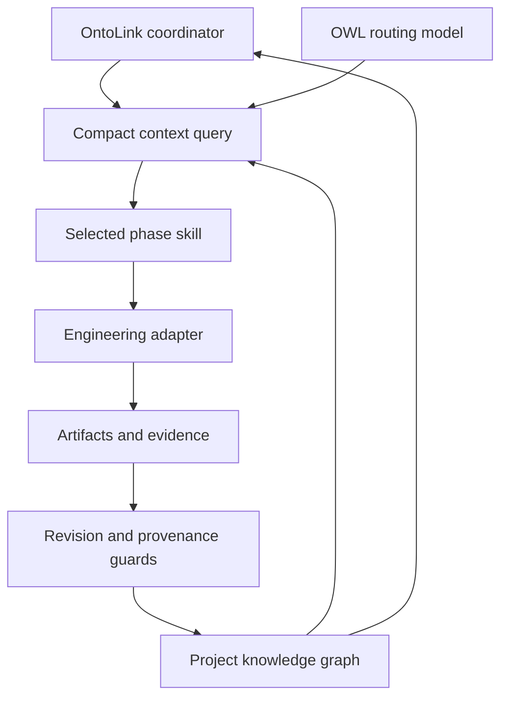

# OntoLink Skills

**Ontology-mediated project execution, from discovery to monitoring.**

OntoLink connects sequential agent skills through an OWL knowledge model and a persistent project graph. It retrieves the current task, relevant dependencies, evidence and signals instead of repeatedly loading every skill and the complete project history.

This repository contains eight dedicated OntoLink skills. Existing full-stack engineering skills remain separate optional adapters. OntoLink coordinates their use; it does not replace their implementation capabilities or bundle the previous full-stack collection.

## How the parts connect



## Sequential skills

| Order | Skill | Required outcome |
| --- | --- | --- |
| Coordinator | `ontolink-skills` | Canonical knowledge, routing and handoffs |
| 1 | `ontolink-discovery` | Requirements and acceptance criteria |
| 2 | `ontolink-architecture` | Reviewed contracts and architecture |
| 3 | `ontolink-planning` | Dependency-aware execution plan |
| 4 | `ontolink-implementation` | Working implementation |
| 5 | `ontolink-verification` | Current verification evidence |
| 6 | `ontolink-delivery` | Authorized delivery and handoff |
| 7 | `ontolink-monitoring` | Observed health and follow-up work |

## Start a project

Install all eight directories under `skills/` through your agent host's supported skill mechanism. Keep the directories together by skill name; phase skills resolve the coordinator by name. Invoke `$ontolink-skills` with your project goal. Optional engineering adapters must be installed separately when needed.

The mediator requires Python 3.10+ and the standard library for normal operation:

```sh
python skills/ontolink-skills/scripts/mediator.py init   --project support-tracker --title "Support Tracker" --output /path/to/project/knowledge.owl
python skills/ontolink-skills/scripts/mediator.py context   --state /path/to/project/knowledge.owl
```

The OWL model is [ontolink.owl](skills/ontolink-skills/assets/ontolink.owl). Its readable Turtle mirror is [ontolink.ttl](skills/ontolink-skills/assets/ontolink.ttl). Operational project knowledge is stored in a separate `knowledge.owl` at the actual project root. JSON is a command payload and compact query result, not the canonical storage format.

## What the graph tracks

Requirements, contracts, tasks, artifacts, evidence, decisions, recommendations, warnings, blockers, actors, communications, confidence assessments, event likelihood and audit events have explicit relationships. Progress is computed from accepted task weights. Confidence measures evidence strength; likelihood concerns a specified event and time horizon. Neither closes a task or overrides a blocker.

A task closes only after predecessor phases are complete, its required artifact has current PASS evidence, and blocking signals are resolved. Changed artifacts, contracts or upstream knowledge reopen affected work. Message records do not send messages; non-draft records require an external receipt.

## Token-use design

Token reduction is an objective, not a measured result. OWL text is not inherently smaller than Markdown. Savings come from selecting the current phase, retaining only relevant dependency closure, referencing long artifacts by path and hash, and reusing state across handoffs. Mandatory blockers, contracts and evidence are retained even when the estimated packet budget overflows. The byte-based estimate covers packet content only; measure actual provider usage before claiming a saving.

## Documentation and validation

- [Quickstart and recording workflow](docs/quickstart.md)
- [Knowledge model and relationships](docs/knowledge-model.md)
- [Lifecycle and handoff rules](docs/lifecycle.md)
- [Validation and limitations](docs/validation.md)
- [Skill catalogue](catalog.json)
- [Primary standards and attribution](SOURCES.md)

```sh
python -m pip install -r requirements-dev.txt
python scripts/check.py
```

The runtime is a constrained named-node RDF/XML mediator, not a general OWL reasoner. Hash checks establish local file provenance; an agent must still inspect whether a proof demonstrates the claimed outcome. Monitoring requires active work or separately configured automation.
