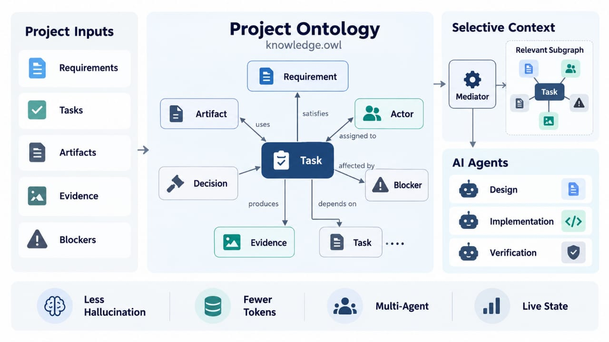
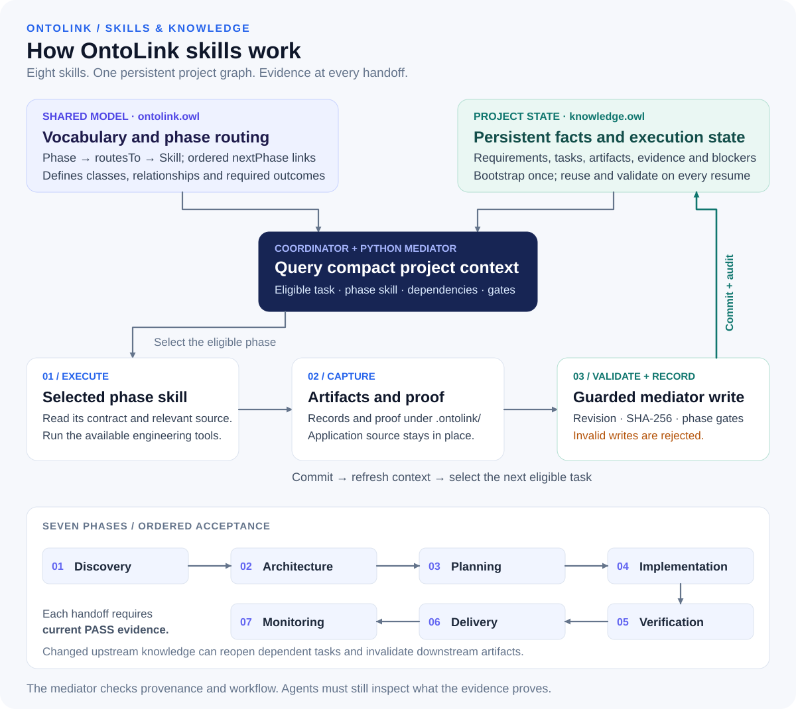

# OntoLink — Skills & Knowledge Orchestration

**Ontology-mediated project execution, from discovery to monitoring.**

OntoLink connects eight agent skills through a shared OWL model and a persistent
project knowledge graph. It retrieves the current task, relevant dependencies,
contracts and evidence so an agent can continue work across sessions without
reloading every skill or the entire project history.

The coordinator manages the workflow. Phase skills provide the procedures for
each stage. Available engineering tools and optional specialist skills perform
the actual implementation, testing and delivery.

## Project ontology and selective context



A conceptual view of project knowledge and selective context. The record contract
defines the exact runtime fields and validation rules; token savings and error
reduction depend on the workload and are not guaranteed by the diagram.

## Ontology update cycle



The execution cycle has three responsibilities:

1. **Model and state.** The shared `ontolink.owl` defines classes, relationships,
   phase order, required outcomes and skill routing. Each project's `knowledge.owl`
   stores its own facts and execution state. They are separate files with separate roles.
2. **Context and execution.** The coordinator queries the Python mediator. The
   resulting packet identifies the eligible task, its phase skill, dependencies,
   linked artifacts and completion gates. The agent reads that phase's contract
   and the relevant source, then performs the work using available tools.
3. **Evidence and persistence.** The agent records factual changes and current
   artifact/proof hashes. The mediator checks revisions, structure, provenance
   and workflow gates before accepting an update. It commits accepted changes
   atomically and logs an audit event. Fresh context guides the next task.

The ontology is semantic data. The mediator applies the operational guards; the
file format does not execute code or enforce a workflow on its own. The runtime
supports a constrained named-node RDF/XML representation, not general OWL reasoning.

## The eight skills

| Order | Skill | Required outcome |
| --- | --- | --- |
| Coordinator | [ontolink-skills](https://github.com/asgmodel/ontolink-skills/blob/main/skills/ontolink-skills/SKILL.md) | Canonical knowledge, routing and handoffs |
| 1 | [ontolink-discovery](https://github.com/asgmodel/ontolink-skills/blob/main/skills/ontolink-discovery/SKILL.md) | Requirements and acceptance criteria |
| 2 | [ontolink-architecture](https://github.com/asgmodel/ontolink-skills/blob/main/skills/ontolink-architecture/SKILL.md) | Reviewed architecture and contracts |
| 3 | [ontolink-planning](https://github.com/asgmodel/ontolink-skills/blob/main/skills/ontolink-planning/SKILL.md) | Execution plan and dependencies |
| 4 | [ontolink-implementation](https://github.com/asgmodel/ontolink-skills/blob/main/skills/ontolink-implementation/SKILL.md) | Working implementation |
| 5 | [ontolink-verification](https://github.com/asgmodel/ontolink-skills/blob/main/skills/ontolink-verification/SKILL.md) | Current verification evidence |
| 6 | [ontolink-delivery](https://github.com/asgmodel/ontolink-skills/blob/main/skills/ontolink-delivery/SKILL.md) | Authorized delivery and handoff |
| 7 | [ontolink-monitoring](https://github.com/asgmodel/ontolink-skills/blob/main/skills/ontolink-monitoring/SKILL.md) | Observed health and follow-up work |

Phase order is enforced when work is accepted. A later phase cannot become ready
or complete while its required earlier phases remain incomplete. Specialist
engineering skills remain optional adapters; OntoLink does not replace their
implementation capabilities or require a particular application stack.

## Project knowledge and completion

The graph represents requirements, contracts, tasks, dependencies, decisions,
artifacts, evidence, blockers, warnings, recommendations, actors and communications.
Relationships such as `dependsOn`, `usesArtifact` and `derivedFrom` connect work
to its inputs and let recorded upstream changes reopen affected tasks or mark
artifacts stale.

A task becomes `DONE` only when its required outcome has current `PASS` evidence,
predecessor phases are complete and blocking signals are resolved. Evidence
references a local proof file and exact SHA-256 hashes for both the proof and its
target artifact. Agents must still inspect whether the proof demonstrates the
claimed outcome; matching hashes alone do not establish correctness.

Progress measures accepted task weight. Confidence describes evidence strength;
likelihood concerns a named event and time horizon. Neither closes tasks nor
overrides blockers. Recording a message does not send it; sent-message records
require a real external receipt and an authorized communication action.

## Install from the terminal

The complete setup requires Git, Python 3.10+ and an existing application project.
Use a separate distribution checkout outside the application. Set `--skills-dir`
to the project skill directory supported by your agent; `.agents/skills` is the
default used in these examples.

```sh
git clone https://github.com/asgmodel/ontolink-skills.git /path/to/ontolink-distribution
python /path/to/ontolink-distribution/scripts/project_setup.py \
  --project /path/to/my-project --skills-dir .agents/skills
```

Setup installs all eight skills and the external rules, merges a managed block
into `AGENTS.md` and `GEMINI.md`, and returns fresh project context. Replaced files
are backed up under `.ontolink/backups/`; unrelated skills, user instructions and
application files are preserved. Reload your agent if its host requires it to
discover installed or updated skills.

The optional community installer can install the skill packages for a supported
agent when Node.js/npm is available:

```sh
npx skills add asgmodel/ontolink-skills --skill '*' --agent codex --yes
```

This installs packages only. Use the complete Python setup for the external rules
and project initialization. Choose one installation method for a target directory.

## First use and everyday operation

At first project use, OntoLink creates or validates and reuses the project's
`knowledge.owl`. Bootstrap derives the initial project identity from the directory
and creates seven incomplete phase obligations. Existing graph bytes and progress
are preserved. An explicitly configured canonical state remains authoritative;
never initialize a second graph to clear an error.

From the application root after setup:

```sh
python .rule/ontolink.py start --root . --skill-root .agents/skills/ontolink-skills
python .rule/ontolink.py context --root . --skill-root .agents/skills/ontolink-skills
```

Read the returned `workflow_skill` and relevant source before acting. The graph
helps navigate the project; it does not replace source-code inspection. If no
task is eligible, address the reported dependency or blocker.

Keep OntoLink-generated JSON and text under the fixed `.ontolink/` directory:
record payloads in `records/`, proof logs in `proofs/` and generated project
artifacts in `artifacts/`. Application source stays in its native location.

Create each payload using the coordinator's record contract, then record it with
the revision observed in current context:

```sh
python .rule/ontolink.py record --root . --skill-root .agents/skills/ontolink-skills \
  --input .ontolink/records/scope-001.json --expected-revision 0
```

The example requires an actual payload and the current revision; later writes
must not blindly reuse revision zero. A successful record validates state and
refreshes context automatically. On a revision conflict, reread and reconcile.
If recording committed but refresh failed, rerun `context` rather than resubmitting
that record. Preserve invalid state and active locks; do not reset or bypass them.

For an existing explicit state path, pass `--state path/to/existing.owl` on every
setup and wrapper command. Generated `.ontolink` files remain beside that state
file, preserving the mediator's relative-path contract.

## Update skills while keeping project data

An existing project can receive new skill instructions, scripts and commands
without rebuilding its knowledge graph. Stop active agent work, then run these
two commands against the original distribution checkout:

```sh
git -C /path/to/ontolink-distribution pull --ff-only origin main
python /path/to/ontolink-distribution/scripts/project_setup.py \
  --project /path/to/my-project --skills-dir .agents/skills
```

Setup validates the existing graph with the incoming mediator before replacing
packages, backs up replaced files, refreshes context, and checks that the existing
graph bytes have not changed. It preserves recorded knowledge, proof files,
generated artifacts and application source. Newly added package commands become
available after installation and any host-required reload.

Copy or refresh failure restores the replaced package, rule and host files.
Backups retain local customizations for deliberate merging. Invalid state or an
incompatible future data format stops the update; this is not an automatic schema
migration. Resolve local Git changes before pulling instead of discarding them.

For an older installation consisting only of copied skill folders, clone the
distribution and run setup with their actual parent directory as `--skills-dir`.
It backs up the previous copies and reuses existing project knowledge. Never copy
a bundled example graph over the application's canonical state.

## Prompts for coding agents

These prompts require an agent with Git access, Python execution and permission
to write the target project. Replace the example paths.

### Install

```text
Install OntoLink Skills from https://github.com/asgmodel/ontolink-skills.git
for /absolute/path/to/my-project. Use a separate distribution checkout.
Read the README and .rule/ONTOLOGY-FIRST.md, resolve this host's project skill
directory, and run scripts/project_setup.py with --project and --skills-dir.
Honor any existing explicit canonical state with --state. Preserve project data,
application files, user instructions and unrelated skills. Inspect fresh context
and report the installed paths, backup location, current revision and any failure.
```

### Update

```text
Update OntoLink for /absolute/path/to/my-project. Identify the existing distribution,
installation method, skill directory and canonical state. Pause active writers,
inspect local changes, and fast-forward the distribution without discarding work.
Read its current instructions and run scripts/project_setup.py against the existing
project, passing --state when configured. Preserve graph bytes, records, proofs,
artifacts and application files. Keep backups and stop on compatibility errors;
do not reset state or invent a migration. Refresh context and report versions,
new commands and any host-required reload.
```

### Start or resume

```text
Use $ontolink-skills for this project. Follow .rule/ONTOLOGY-FIRST.md and resolve
the installed coordinator. Create or reuse the canonical state with start,
query current context and continue the eligible phase. Inspect relevant source,
perform the authorized work, and keep generated JSON and text under .ontolink.
Record factual changes with the observed revision, refresh context after records,
and preserve the project's architecture and user changes.
```

## Comparison with other skills and Markdown

| Aspect | OntoLink Skills | A specialist engineering skill | Markdown project notes |
| --- | --- | --- | --- |
| Main role | Coordinate phases and persistent project knowledge | Perform a domain task using its tools | Explain decisions and context |
| Continuity | Canonical graph, revisions and selected context | Depends on the skill's implementation | Depends on what is recorded and reread |
| Dependencies | Explicit relationships and phase acceptance gates | Depends on the skill | Usually described in prose or links |
| Evidence | Artifact/proof hashes and workflow guards | Depends on the skill | Described or linked |
| Best use | Coordinate a project across phases and sessions | Implement or verify concrete outcomes | Document human-readable rationale |

These are complementary responsibilities, not benchmark rankings. Some specialist
skills also provide state and validation. OntoLink coordinates them without
replacing their capabilities. Markdown remains useful alongside the graph for
long explanations and narrative decisions.

## Frequently asked questions

### What happens when an update adds commands to a project that already has data?

Run the two update commands above. They update package code and rules while
retaining the separate project graph and durable files. New commands can use that
state if the format remains compatible; updating a package is not proof of migration.

### Does the ontology eliminate hallucinations or prove a product is correct?

No. The mediator checks structure, local provenance and workflow gates. Agents
must inspect source, test semantics and acceptance criteria. External receipts
and real-world outcomes still require actual tool evidence.

### Does OWL guarantee lower token costs?

No. The intended saving comes from selective retrieval and reusing state, not
from OWL being inherently smaller than Markdown. The packet's byte-based estimate
is not a provider token count. Measure actual usage before reporting savings.

### Can I delete `.ontolink` to clean the project?

Do not delete the whole directory. It contains durable records, proof and artifacts.
Only context packets and the generated code index are rebuildable caches. Preserve
all files referenced by canonical state, and keep secrets out of proof logs.

### What does the optional Project Intelligence extension do?

It provides a generated code index and local BM25 retrieval for file and symbol
navigation. The index at `.ontolink/index/project-index.json` is separate from
canonical state, is rebuildable and never counts as completion evidence. Enable
it with `start --index` using the installed coordinator path.

### Does monitoring run continuously?

Monitoring operates during active work and resume. Background monitoring requires
separate automation; installing or invoking a skill does not create an always-on service.

## References and validation

- [Quickstart and recording](https://github.com/asgmodel/ontolink-skills/blob/main/docs/quickstart.md)
- [Knowledge model](https://github.com/asgmodel/ontolink-skills/blob/main/docs/knowledge-model.md) and [lifecycle](https://github.com/asgmodel/ontolink-skills/blob/main/docs/lifecycle.md)
- [Project Intelligence](https://github.com/asgmodel/ontolink-skills/blob/main/docs/project-intelligence.md)
- [Validation and limitations](https://github.com/asgmodel/ontolink-skills/blob/main/docs/validation.md)
- [Execution contract](https://github.com/asgmodel/ontolink-skills/blob/main/skills/ontolink-skills/references/execution-contract.md) and [record contract](https://github.com/asgmodel/ontolink-skills/blob/main/skills/ontolink-skills/references/record-contract.md)
- [Standards and attribution](https://github.com/asgmodel/ontolink-skills/blob/main/skills/ontolink-skills/assets/sources.json)

From the distribution checkout:

```sh
python -m pip install -r requirements-dev.txt
python scripts/check.py
```
