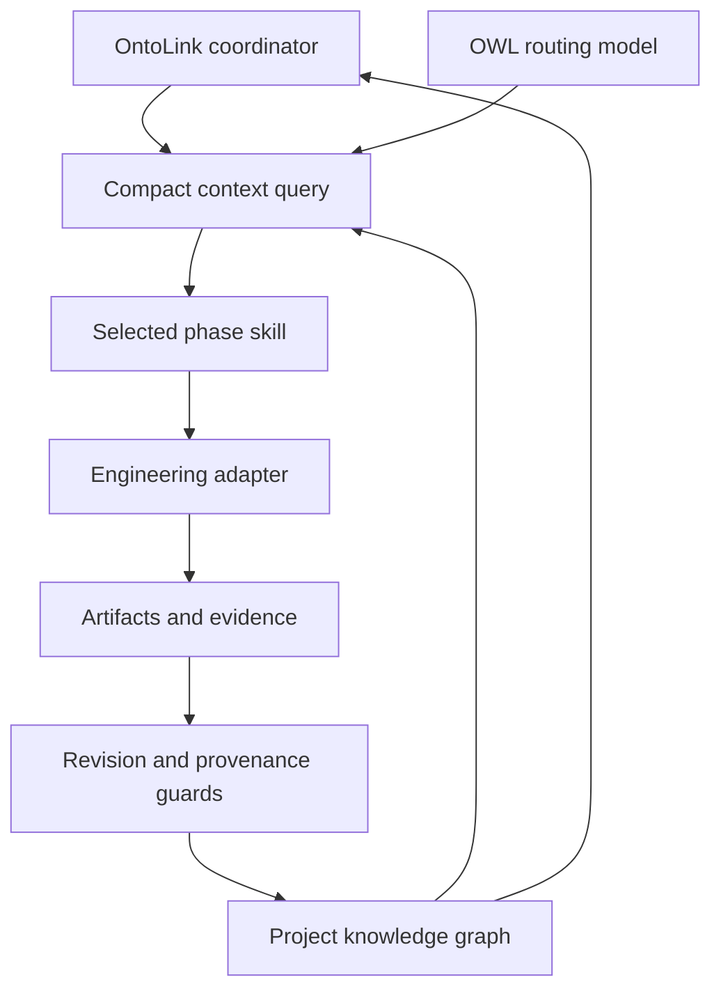

# OntoLink Skills

**Ontology-mediated project execution, from discovery to monitoring.**

OntoLink connects sequential agent skills through an OWL knowledge model and a persistent project graph. It retrieves the current task, relevant dependencies, evidence and signals instead of repeatedly loading every skill and the complete project history.


## How the parts connect



## Sequential skills

| Order | Skill | Required outcome |
| --- | --- | --- |
| Coordinator | `ontolink-skills` | Canonical knowledge, routing and handoffs |
| 1 | `ontolink-discovery` | Requirements and acceptance criteria |
| 2 | `ontolink-architecture` | Reviewed contracts and architecture |
| 3 | `ontolink-planning` | Dependency-aware execution plan |
| 4 | `ontolink-implementation` | Working implementation |
| 5 | `ontolink-verification` | Current verification evidence |
| 6 | `ontolink-delivery` | Authorized delivery and handoff |
| 7 | `ontolink-monitoring` | Observed health and follow-up work |

## Start a project

Install all eight directories under `skills/` through your agent host's supported skill mechanism. Keep the directories together by skill name; phase skills resolve the coordinator by name. Invoke `$ontolink-skills` with your project goal. Optional engineering adapters must be installed separately when needed.

The mediator requires Python 3.10+ and the standard library for normal operation:

```sh
python skills/ontolink-skills/scripts/mediator.py init   --project support-tracker --title "Support Tracker" --output /path/to/project/knowledge.owl
python skills/ontolink-skills/scripts/mediator.py context   --state /path/to/project/knowledge.owl
```

The OWL model is [ontolink.owl](skills/ontolink-skills/assets/ontolink.owl). Its readable Turtle mirror is [ontolink.ttl](skills/ontolink-skills/assets/ontolink.ttl). Operational project knowledge is stored in a separate `knowledge.owl` at the actual project root. JSON is a command payload and compact query result, not the canonical storage format.

## What the graph tracks

Requirements, contracts, tasks, artifacts, evidence, decisions, recommendations, warnings, blockers, actors, communications, confidence assessments, event likelihood and audit events have explicit relationships. Progress is computed from accepted task weights. Confidence measures evidence strength; likelihood concerns a specified event and time horizon. Neither closes a task or overrides a blocker.

A task closes only after predecessor phases are complete, its required artifact has current PASS evidence, and blocking signals are resolved. Changed artifacts, contracts or upstream knowledge reopen affected work. Message records do not send messages; non-draft records require an external receipt.

## Token-use design

Token reduction is an objective, not a measured result. OWL text is not inherently smaller than Markdown. Savings come from selecting the current phase, retaining only relevant dependency closure, referencing long artifacts by path and hash, and reusing state across handoffs. Mandatory blockers, contracts and evidence are retained even when the estimated packet budget overflows. The byte-based estimate covers packet content only; measure actual provider usage before claiming a saving.

## Documentation and validation

- [Quickstart and recording workflow](docs/quickstart.md)
- [Knowledge model and relationships](docs/knowledge-model.md)
- [Lifecycle and handoff rules](docs/lifecycle.md)
- [Validation and limitations](docs/validation.md)
- [Skill catalogue](catalog.json)
- [Primary standards and attribution](SOURCES.md)

```sh
python -m pip install -r requirements-dev.txt
python scripts/check.py
```

The runtime is a constrained named-node RDF/XML mediator, not a general OWL reasoner. Hash checks establish local file provenance; an agent must still inspect whether a proof demonstrates the claimed outcome. Monitoring requires active work or separately configured automation.


---

## Project ontology: automatic setup and practical operation

### 1. Automatic creation at the project root

When an AI agent first uses OntoLink in a project, it must automatically create or reuse `knowledge.owl` in the actual project root before starting phase work. The user does not need to ask for an ontology file or repeat a setup instruction. The agent resolves the target project, inspects existing canonical state, and invokes the bundled mediator's `bootstrap` command. Installation alone does not execute code; automatic setup happens during the first project-scoped invocation in a host that can run Python and write project files.

```sh
python <skill-root>/scripts/mediator.py bootstrap --root "<project-root>"
```

The command derives a project ID and title from the directory name unless explicitly supplied, creates seven incomplete phase tasks, and returns a context packet. If `knowledge.owl` already exists, it validates and reuses the file without rewriting its contents or resetting progress. An explicitly configured canonical state path remains authoritative; the agent must not create a second graph. An ambiguous root must be resolved before writing. Invalid state, an active writer lock, or missing capabilities must be reported rather than concealed by reinitialization.

### 2. What the ontology file represents

`knowledge.owl` is the project's persistent knowledge and execution state graph. It records requirements, contracts, tasks, dependencies, artifacts, evidence, decisions, blockers and other operational signals as explicit nodes and relationships. It is distinct from the bundled `ontolink.owl` schema, which defines the vocabulary and workflow routing. Keeping these responsibilities separate lets many projects share the same model while retaining independent state.

The state uses RDF/XML and OWL vocabulary. It is semantic data, not executable application code. The Python mediator reads the supported representation, queries focused context and enforces operational guards. Its parser is deliberately constrained to named-node RDF/XML; it is not a general OWL reasoner and does not support arbitrary RDF/XML constructs.

### 3. How persistent knowledge supports a project

The root graph gives future sessions a durable starting point: what has been accepted, what remains open, which outcomes are required and which dependencies matter. A new agent queries the current graph and inspects the relevant source and evidence before continuing. Persistence supports continuity, but accuracy still depends on recording real changes and keeping the graph synchronized with the project.

OntoLink coordinates discovery, architecture, planning, implementation, verification, delivery and monitoring. Required outcomes and predecessor guards prevent accepted completion from skipping earlier obligations. The initialized tasks describe work to perform; they are not proof that a product has been built, tested or deployed.

### 4. Evidence, provenance and completion

A task can become `DONE` only when its required outcome has current `PASS` evidence, predecessor phases are complete and blocking signals are resolved. Evidence references a local proof file and SHA-256 hashes for both the proof and its target artifact. These checks detect mismatches and establish traceable local provenance.

A matching hash does not prove that a test ran, that the proof is meaningful or that the software is correct. The agent must inspect the command, environment, output and acceptance criteria before recording `PASS`. This makes unsupported completion claims harder to accept through the mediator, but does not eliminate hallucination. Progress measures accepted task weight, not overall product quality; confidence and likelihood never substitute for completion evidence.

### 5. Selective retrieval and token use

OWL is not inherently smaller than Markdown. The intended efficiency comes from retrieving focused context instead of repeatedly loading the full graph, every skill and the complete project history. A context packet selects the current task, relevant dependency closure, contracts, blockers and evidence references. Long artifacts remain in files and are read selectively when needed.

Packet size depends on project complexity, dependency depth and required facts. There is no guaranteed character range or measured universal token saving. The mediator's budget is a byte-based estimate for packet content; mandatory facts remain even if the estimate overflows. Measure actual provider usage, including skill instructions and tool output, before claiming a percentage reduction.

### 6. What an agent reads before changing code

The agent first queries the mediator to establish the current task, phase and constraints. It then reads the relevant source files, tests, configuration and evidence required for that work. The graph guides navigation; it does not contain or replace the complete application source. A wider inspection remains appropriate when dependencies or an unfamiliar architecture require it.

After a meaningful change, the agent records the new facts and artifact revisions through the mediator, queries fresh context and validates the state before handoff. Writes use the observed revision and a cooperating-writer lock. A revision conflict requires rereading current state, not bypassing the guard.

### 7. Change impact and monitoring

Relationships such as `dependsOn`, `usesArtifact` and `derivedFrom` connect work to its prerequisites and inputs. Recorded upstream changes can reopen reachable tasks and mark dependent artifacts stale. Unexpected file-byte changes are detected during validation; they require reconciliation and a recorded revision before normal work continues. Impact tracking is only as complete as the relationships that have been recorded.

Resolving a blocker makes work eligible again; it does not restore stale evidence or manufacture completion. Monitoring occurs during active work and resume. Continuous background monitoring requires separately configured automation. Similarly, message records do not send messages, and a graph entry cannot prove an external deployment or provider integration without actual receipts.

### 8. Ontology and Markdown work together

Markdown serves human explanation, narrative decisions and documentation. The ontology gives selected project facts explicit identities, relationships and queryable state. The mediator supplies the programmatic guards; the file format alone does not enforce governance. Both formats are useful when their responsibilities are clear.

| Aspect | Markdown documentation | OntoLink project graph |
| --- | --- | --- |
| Primary purpose | Human explanation and context | Structured operational knowledge |
| Relationships | Described in prose or links | Explicit graph edges |
| Validation | Depends on document tooling | Mediator guards and optional SHACL checks |
| Change impact | Usually tracked manually | Traverses recorded dependencies |
| Evidence | Described or linked | Artifact and proof hashes with outcome records |
| Best use | Guides and narrative rationale | State, routing and controlled handoffs |

Keep the graph in the project alongside its source, keep secrets out of records and proof logs, and use Markdown for the explanation people need. This combination supports repeatable AI-assisted engineering with durable context and reviewable evidence.

**Implementation references:** [Coordinator instructions](skills/ontolink-skills/SKILL.md), [Python mediator](skills/ontolink-skills/scripts/mediator.py), [execution contract](skills/ontolink-skills/references/execution-contract.md), [knowledge model](docs/knowledge-model.md), and [lifecycle](docs/lifecycle.md).
